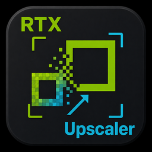
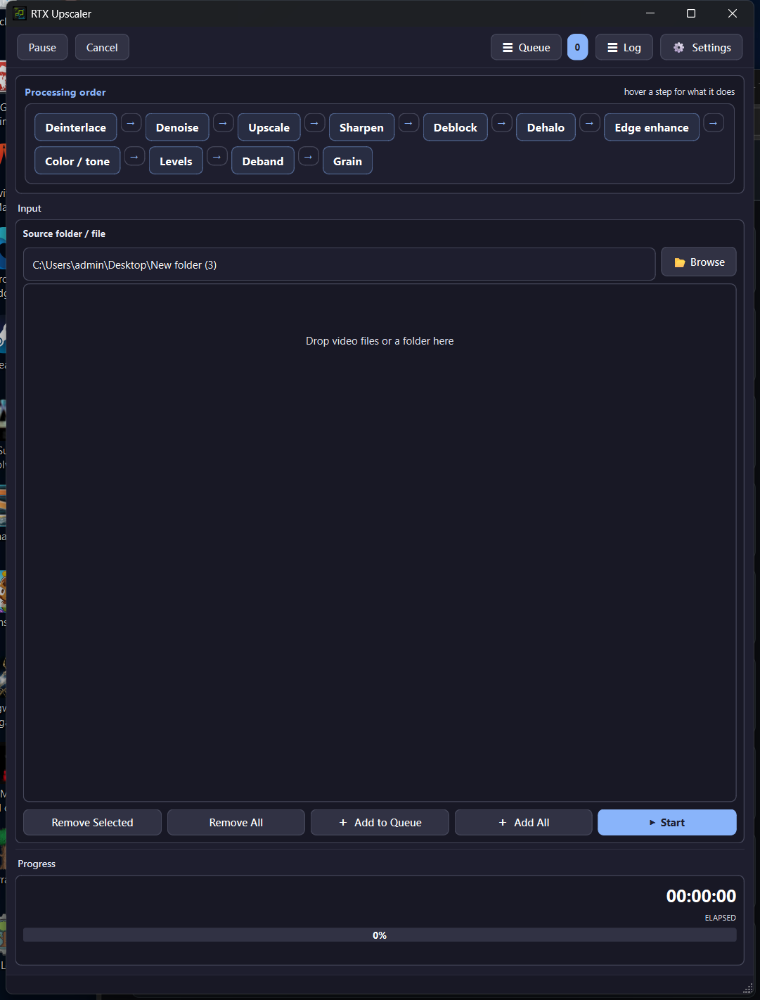
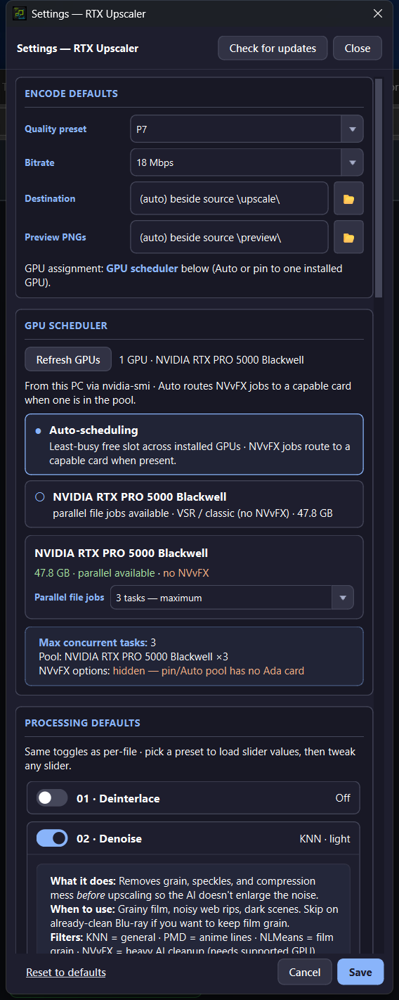

# RTX Upscaler

  

  
  
  
  

---

## What is RTX Upscaler?

**RTX Upscaler makes videos look bigger and cleaner on an NVIDIA GPU.**

Example: a soft **720p** or **1080p** file -> **4K**, with optional cleanup (noise, blocks, soft edges) so the enlarge step does not blow up compression junk.

You do **not** need command lines or encoding geekery. The app is a Windows window:

1. Drop your video(s) in
2. Leave the defaults (or flip a few steps on/off)
3. Click **Start** - finished files land in an `\upscale\` folder next to your source

The heavy lifting is **NVIDIA Video Super Resolution (VSR)** via NVEncC (works on modern RTX cards). Optional **NVvFX** AI filters (heavy denoise / SuperRes) need an **Ada** GPU (compute 8.9, e.g. RTX 40-series). On Blackwell-only machines those NVvFX options stay hidden; **VSR still works**.

### What happens to each file

Think of it as a **cleanup chain**, then enlarge, then polish:

| Step | In plain words |
|------|----------------|
| **Deinterlace** | Fix old TV / 1080i combing into normal progressive frames (off if your file is already progressive). |
| **Denoise** | Remove grain and speckles *before* enlarge so noise does not get bigger. |
| **Upscale** | Grow the picture (VSR AI, or classic math like Lanczos). Default sweet spot: **VSR 3**. |
| **Sharpen / Deblock / Dehalo / Edge** | Put crispness back, soften blocks, kill halos, optionally pop anime lines. |
| **Color / Levels / Deband / Grain** | Light tone fixes, banding cleanup, optional film grain so AI results do not look plastic. |

Then it **encodes on the GPU** and keeps your original audio / subs when remuxing. Defaults aim at "drop in and go": **VSR**, quality **P7**, output beside the source under `\upscale\`.

Hover any step in the app for a short "what it does / when to use" tip.

---

## Screenshots

  

<em>Main window - processing order, drop zone, Start.</em>

  

<em>Settings - encode defaults, GPU scheduler, per-step processing (with in-app help).</em>

---

## How to use (quick start)

1. Install from [Releases](https://github.com/aberthil/RTXUpscaler-releases/releases/latest) and open **RTX Upscaler**.
2. **Browse** or **drag-and-drop** video files (or a folder).
3. Optional: click a pipeline step (or open **Settings**) to turn filters on/off or change VSR strength / resolution.
4. **+ Add to Queue** (or **Add All**), then **Start**.
5. When it finishes, open the `\upscale\` folder next to your source (or your custom destination).

**Queue / Log / Notification / Settings** are top-right. Pause and Cancel work while a job runs. Multi-GPU machines can auto-schedule parallel jobs; NVvFX jobs route to an Ada card when one is present.

---

## Remote progress (LAN page + PushWard live card)

Watch the queue from your phone or another PC. Read-only: **basename only**, no remote control, no disk paths.

Remote is **on by default**. Open **Settings → Remote progress** for the LAN URL and **QR code** (default port **8766**). Setup allows Private/Domain LAN for the app so Windows should **not** prompt for network access.

### PushWard Live Activity / Live Update (works off LAN)

Best glanceable progress when you are not on the same Wi‑Fi as the encode PC.

| | |
|--|--|
| **What you get** | **One** Live Activity / Live Update card for the whole queue — lead job **% · fps · elapsed**, plus running / waiting counts |
| **Tap** | Opens the full LAN queue page (when you are back on the same network) |
| **iPhone** | Lock Screen / Dynamic Island via **PushWard** (iOS 26+). Enable **Live Activities** and **More Frequent Updates** in PushWard Settings |
| **Android** | **Live Update** in the notification shade via **PushWard** (Android 12+) |
| **Setup** | Settings → Remote progress → enable **PushWard Live Activity** → paste your PushWard integration key (`hlk_…`) |
| **Same key** | One `hlk_…` key covers iPhone + Android, and optional one-shot alerts under **Notification → Formatted text → PushWard** |

Free PushWard quotas apply (Live Activity / Live Update updates per month). This path is for **live progress** — not a replacement for the full queue page.

### Web page (same LAN)

Open `http://<pc-ip>:8766/` (or scan the QR). It refreshes on the same cadence as Settings (default **every 2 seconds**, range 1–60).

| Section | What you see |
|--|--|
| **Now encoding** | One full card **per running GPU slot** — title, %, step, fps, ETA |
| **Waiting in queue** | Ordered list with **# NEXT** so you know what starts when a slot frees |
| **Finished** | Recent completed / failed / cancelled jobs |

### Add Tracker (home / menu bar / top bar)

On the remote page open **Add RTX Upscaler Tracker**. Same status feed the page uses:

| Client | How |
|--|--|
| **iOS / iPadOS** | **PushWard Live Activity** (above), or Safari **Add to Home Screen** for the full live page |
| **Android** | **PushWard Live Update** (above), or download **`RTX Upscaler.kwgt`** for KWGT (tap **↻ Refresh** to force-update; no browser) |
| **macOS (SwiftBar)** | Download `/swiftbar` and drop it in your SwiftBar plugin folder |
| **Windows (Rainmeter)** | Use the skin from `/rainmeter` (polls `/api/widget.txt`) |
| **Linux** | Chrome/Chromium **Install page as app**, terminal `watch` + `/api/widget.txt`, or **Argos** (GNOME) / **Kargos** (KDE) using the same `/swiftbar` plugin |
| **Anything else** | `GET /api/widget` (JSON), `/api/widget.txt` (plain), `/api/widget.png` (card image), `/api/status` (full queue JSON) |

Tap a tracker / card to open the full queue page when you can reach the PC. **Live percent** on phones off-LAN is PushWard; LAN page/widgets poll locally. One-shot **Notification** pings are for start / done / fail / cancel / queue finished — not every percent tick.

---

## Notifications

Toolbar **Notification** (same style as Settings) configures who gets pings. Pill on/off per service and per event.

### When it fires

| Event | Typical use |
|--|--|
| **Job started** | Optional "encode began" ping |
| **Each file done / failed** | Per-file result |
| **Cancel / error stop** | Interrupted job |
| **Queue finished** | Batch summary (done / failed / total time) |

Message templates use placeholders like `{file}`, `{status}`, `{elapsed}`, `{queue}`, `{done}`, `{failed}`.

### Services (enable any mix)

**PushWard** (Formatted text — same `hlk_…` key as Live Activity) · Pushover · ntfy · Pushbullet · SimplePush · PushSafer · Push: Real-time alerts · PushMe · PushDeer · Telegram · Discord (optional rich embeds) · Slack · Matrix · Stoat / Revolt · generic webhook · email · plain log lines

Credentials stay in AppData and survive App Update. Use **Test** in the Notification window before relying on a service.

---

## Download

| | |
|--|--|
| **Latest Setup** | [RTXUpscaler-2.0.9-Setup.exe](https://github.com/aberthil/RTXUpscaler-releases/releases/latest/download/RTXUpscaler-2.0.9-Setup.exe) |
| **All versions** | [Releases](https://github.com/aberthil/RTXUpscaler-releases/releases) |
| **SHA-256** | [RTXUpscaler-2.0.9-Setup.exe.sha256](https://github.com/aberthil/RTXUpscaler-releases/releases/latest/download/RTXUpscaler-2.0.9-Setup.exe.sha256) |

> Prefer the **latest** tag always:  
> https://github.com/aberthil/RTXUpscaler-releases/releases/latest

Installs to `C:\DolbyVisionScripts\RTXUpscaler` by default. Settings / Notification / queue / remote prefs live in AppData and **survive App Update**. Only a full **Remove** wipes them.

Setup is large (~1.5 GB) because it ships the owned **VSR** (`nvcc_libs`) and **NVvFX** (`nvfx`) tool trees - no scavenger hunt for DLLs after install.

---

## Requirements

| | |
|--|--|
| OS | Windows 10/11 **x64** |
| GPU | **NVIDIA** RTX recommended |
| VSR (main upscale) | Modern RTX with NGX VSR support |
| NVvFX extras | **Ada** (compute 8.9) - denoise / artifact / SuperRes; hidden if no Ada in the pool |
| Disk | Large Setup + room for working files beside your sources |
| Remote / widgets | Same LAN as the encode PC (Wi-Fi / Ethernet) |

---

## Install

1. Download **RTXUpscaler-*-Setup.exe** from [Releases](https://github.com/aberthil/RTXUpscaler-releases/releases/latest)
2. Run Setup (admin)
3. Launch **RTX Upscaler** from the Finish page / Start Menu

**Update the app:** Settings -> Check for updates / App update  
(keeps AppData userdata; Tool updates != App update)

---

## Upscale engines (when you care)

| Path | Notes |
|------|--------|
| **VSR 1-4** | NVIDIA Video Super Resolution - default everyday AI enlarge. **VSR 3** = balanced; **VSR 4** = rough sources |
| **Classic** (spline / Lanczos / ...) | Neutral resize, no neural look |
| **NVvFX SuperRes** | Ada-only neural upscale; **2x / 3x / 4x** only (no "same size") |
| **NVvFX Denoise / Artifact** | Ada-only heavy AI cleanup before or instead of light filters |

---

## What's New

### v2.0.9

- **PushWard Live Activity / Live Update** — one queue progress card on iPhone (Lock Screen / Dynamic Island) and Android (notification Live Update); tap opens the LAN page
- Same `hlk_…` key under **Remote progress** (live card) and **Notification → Formatted text → PushWard** (one-shot alerts)
- **Add Tracker** tabs match Tekno (iOS / Android / macOS / Windows / **Linux** with browser + terminal + Argos)

### v2.0.4

- Remote progress: **no Windows LAN access popup** — Setup adds a Private/Domain firewall allow (remote stays on by default)

### v2.0.3

- **Notification** window uses the same **pill on/off** switches as Settings (not square checkboxes)
- Settings **QR code** for Remote progress (segno packaged in the Setup)
- Project page: full **Remote page + widgets** and **multi-service Notification** docs

### v2.0.1 / v2.0.0

- **Remote progress** — LAN status page + Scriptable / SwiftBar / Rainmeter widgets; full line per running job; Waiting / Finished; poll every 2s (1–60); **on by default**; QR in Settings
- **Notification** toolbar button — Tekno-parity multi-service stack (Pushover, Telegram, Discord, ntfy, Slack, Matrix, Email, Stoat, Pushbullet, SimplePush, PushSafer, PushMe, PushDeer, Webhook, …) with start / each-file / cancel / queue-done
- Queue-aware remote UI for parallel GPU slots
- Prior 1.0.x encode/mux reliability fixes retained (interlace frame counts, attached_pic track pick, mov_text→ASS, near-complete exit accept)

### Earlier

See the [Releases](https://github.com/aberthil/RTXUpscaler-releases/releases) page for notes on each Setup build.

---

## Links

- **Latest download:** https://github.com/aberthil/RTXUpscaler-releases/releases/latest
- **This repo:** public Setup hosting + project page (source stays private)

---

## License / support

Windows installers for end users. Problems with a specific Setup: note the release tag and contact the publisher (`aberthil`).
